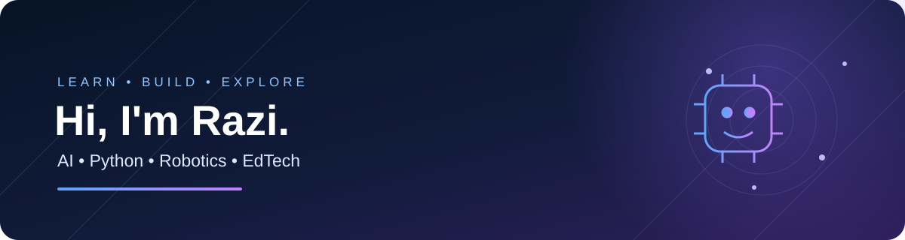

<!-- Profile README for moeinim351-afk -->

### Curious learner building with AI, Python, and robotics.

I’m **Razi**, a student exploring how intelligent systems work — from code and experiments to useful learning tools.

---

## About me

- 🧠 Learning **Python, artificial intelligence, and machine learning** step by step.
- 🤖 Exploring **robotics, computer vision, and intelligent agents**.
- 📚 Interested in building technology that makes learning more engaging and accessible.
- 🧪 Learning by experimenting, documenting progress, and improving projects over time.
- 🌱 Currently focused on strengthening programming fundamentals and turning ideas into working prototypes.

## What I'm working toward

| Area | Current focus |
| --- | --- |
| Programming | Python fundamentals and writing clearer code |
| AI & ML | Understanding core concepts and testing small experiments |
| Robotics | Connecting software, sensors, and intelligent behavior |
| Educational technology | Designing useful tools for students and teachers |

## Featured repositories

## Tools & topics

## My approach

> Learn the fundamentals. Build small experiments. Test ideas. Improve one step at a time.

I’m at the beginning of my journey, so this profile will grow alongside my skills. I aim to share real progress, experiments, and projects as I learn.

---

  Thanks for visiting my profile — more experiments coming as I learn.

